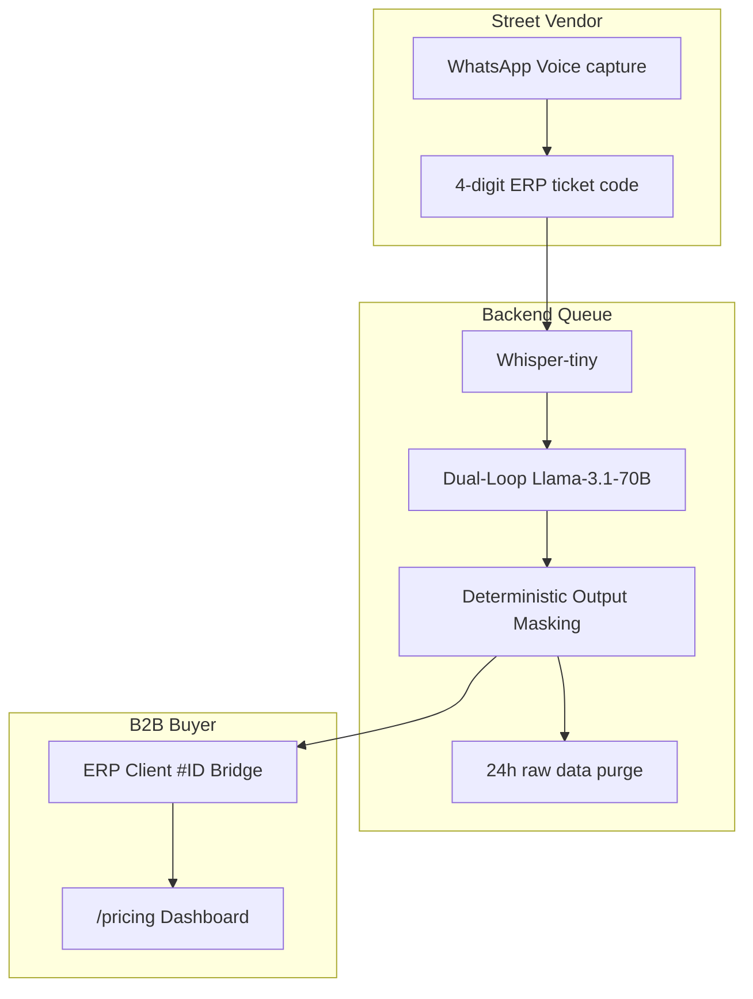

# Semana 13 — Packet Before Code

## Week 14 — Pricing: The Number That Tells the Truth

### Problem Statement & Target User

Informal merchants in Mexico, represented by Doña Mari, age 54, at Metro Tacubaya, need access to commercial credit (*fiado*) without fearing tax surveillance. FMCG distributors and micro-insurers need verified cash-flow telemetry to make safer operational and credit decisions.

### Success Definition

Before this module closes, `/pricing` is live on Vercel with an interactive Revenue Simulator and saved scenarios in browser `localStorage`, and `/about` is live with the 10:1 Value Memo. Refreshing either route must load the SPA rather than return a 404. The Week 13 tactile/acoustic voice-capture flow remains intact at `/`.

### Swimlane

### Global → Local Benchmark

- **Tala:** Its heavy APK requires SMS access, creating fear of SAT scrutiny. We avoid that invasive pattern and focus on consent-based voice and distributor records.
- **JUMO:** Its data model relies on Telcel's data monopoly. We localize the signal by anchoring it to the distributor's ERP records instead.
- **LenddoEFL:** Its 30-minute psychometric tests are a poor fit for a busy street merchant. We localize onboarding through passive analysis of a 30-second voice cadence, subject to consent and privacy safeguards.

### 3-Year Light Charter & Scope Cut

The three-year direction is a lightweight, consent-based trust and cash-flow signal connecting informal merchants to responsible B2B credit and insurance. This cut does **not** build real payment gateways or live ERP integrations. Dashboard prices, ERP bridges, model accuracy, and service levels describe the product offer, not integrations or guarantees implemented by this frontend.

### Architecture & Stack

| Area | Week 14 choice |
|---|---|
| UI | Existing Vite + React application; retain the Week 13 capture screen at `/` |
| Navigation | `react-router-dom` routes for `/`, `/pricing`, and `/about` |
| Deployment routing | Vercel SPA rewrite to `/index.html` |
| Revenue calculations | Client-side deterministic calculations using bounded numeric inputs |
| Scenario storage | Browser `localStorage`; simulated presets and user-created assumptions only |
| Privacy | No real personal data in presets; no external database or API secrets |

### Mechanical Test Plan

1. Build with `npm run build`.
2. Verify route navigation and retain the existing capture page without modifying its recording handlers or controls.
3. Check all simulator slider bounds, default month-six totals, gross margin, and the zero-volume/zero-revenue case.
4. Save, load, compare, and delete scenarios; validate names and ensure presets are visibly labeled `SIMULATED DATA`.
5. Inspect responsive layout at a 360px viewport and verify the Vercel SPA rewrite.

## Diagrama de flujo de trabajo

El diagrama describe el recorrido desde la captura hasta la tarjeta de confianza. IndexedDB conserva fragmentos recuperables; una interrupción del navegador no puede mantener activa la grabación, por lo que la recuperación retoma únicamente lo que alcanzó a persistirse. El almacenamiento del navegador está sujeto a cuota y políticas del dispositivo.

```mermaid
flowchart LR
    subgraph UI["UI del Vendedor — React / Client"]
        direction TB
        Start["Vendedor inicia captura"]
        Haptic["Un pulso táctil corto<br/>navigator.vibrate"]
        Capture["Captura de micrófono<br/>MediaRecorder / OGG-OPUS"]
        Indicator["Indicador tenue en pantalla<br/>verde: buffer activo<br/>amarillo: pausa / pendiente"]
        VAD{"¿Silencio por más de 4 s?"}
        Pause["Pausar silenciosamente la captura<br/>sin enviar petición final"]
        Manual{"¿Cierre manual?"}
        DoubleHaptic["Doble pulso táctil<br/>navigator.vibrate"]
        Resume["Reanudar captura cuando<br/>el vendedor esté listo"]
        Assemble["Unificar fragmentos disponibles<br/>y validar tamaño"]
        ShowCard["Mostrar la tarjeta de confianza técnica"]
        Start --> Haptic --> Capture
        Capture --> Indicator
        Capture --> VAD
        VAD -- "No" --> Capture
        VAD -- "Sí" --> Pause
        Pause --> Indicator
        Pause --> Manual
        Manual -- "No; cliente requiere atención" --> Resume
        Resume --> Capture
        Manual -- "Sí" --> DoubleHaptic --> Assemble
    end

    subgraph IDB["Disco Local — IndexedDB"]
        direction TB
        Persist["Guardar fragmento en transacción atómica<br/>status: pending_upload"]
        Durable["Persistencia administrada por el navegador<br/>cuota y permiso sujetos al dispositivo"]
        Scan["Al iniciar la app, buscar fragmentos<br/>pending_upload y recuperables"]
        Queue["Reconstruir cola de sincronización<br/>sin descartar fragmentos huérfanos"]
        Persist --> Durable
        Scan --> Queue
    end

    subgraph EDGE["Cloudflare Edge — Workers AI"]
        direction TB
        Receive["Recibir POST con audio unificado<br/>validar tipo y tamaño del payload"]
        Preprocess["Preprocesar audio y reducir ruido<br/>antes de la inferencia"]
        Whisper["Workers AI: Whisper-tiny<br/>transcripción del audio"]
        Clean["Normalizar y preparar texto<br/>sin asumir traducción semántica automática"]
        Receive --> Preprocess --> Whisper --> Clean
    end

    subgraph LLM["Backend LLM B2B"]
        direction TB
        Ingest["Ingerir JSON estructurado<br/>con texto validado"]
        Validate["Validar esquema, longitud<br/>y contenido antes de consultar el modelo"]
        Trust["Emitir Technical Trust Card"]
        Ingest --> Validate --> Trust
    end

    Capture -- "Fragmentos de audio" --> Persist
    Pause -- "Resguardar lo capturado" --> Persist
    Durable -- "Fragmentos disponibles" --> Assemble
    Assemble -- "POST autenticado; payload acotado" --> Receive
    Clean -- "JSON validado; secretos solo en servidor" --> Ingest
    Trust --> ShowCard

    AndroidKill["Falla: Android mata la pestaña<br/>por presión de memoria durante la grabación"]
    BrowserRecovery["En el siguiente arranque:<br/>inicializar IndexedDB y escanear fragmentos"]
    LostTail["La porción aún no persistida puede perderse;<br/>no se promete recuperar audio en RAM"]
    AndroidKill -. "cierre abrupto" .-> BrowserRecovery
    AndroidKill -. "límite de recuperación" .-> LostTail
    BrowserRecovery --> Scan
    Queue -- "Sincronizar cuando haya red<br/>y consentimiento/condiciones válidas" --> Receive
```

### Comportamiento ante interrupciones

- **Pausa de más de cuatro segundos:** el VAD pausa silenciosamente el stream, conserva el fragmento ya capturado en IndexedDB con estado `pending_upload` y no envía una petición final. La captura puede reanudarse cuando el vendedor esté listo.
- **Pestaña terminada por Android:** al volver a abrir la aplicación, la inicialización examina IndexedDB y recupera los fragmentos persistidos para reconstruir la cola de sincronización. El audio que seguía únicamente en memoria al momento del cierre no es recuperable; el flujo debe tolerar fragmentos incompletos y no presentarlos como una sesión completa.

## Prompt de generación de imagen para mockup UI/UX

Mockup editorial fotorrealista de una aplicación móvil de asistencia para una comerciante de comida en un puesto callejero de la Ciudad de México, en una escena cotidiana y digna, no publicitaria. Un teléfono Android de gama baja de aproximadamente 2019 está colocado sobre un mostrador gastado de madera o metal rústico, junto a un comal caliente, varios tlacoyos recién hechos y vasos de jugo; al fondo, un mercado urbano concurrido y ligeramente desenfocado, con luz natural de calle y ambiente auténtico. La pantalla del teléfono muestra una interfaz React móvil extremadamente simple, legible y de alto contraste, con un botón central grande pensado para tocarse con facilidad y una superficie visual despejada. No mostrar números, cuenta regresiva, cronómetro, gráficos complejos ni párrafos. Incluir solo etiquetas breves e intuitivas en español, por ejemplo “Escuchando” o “En pausa”. Representar el estado del búfer mediante un pequeño indicador luminoso LED simulado en pantalla, muy tenue y sin destellos agresivos: verde suave mientras el audio se captura y amarillo cálido cuando el sistema está en pausa o resguardando un fragmento; el color nunca debe ser la única señal de estado. El diseño transmite calma, respeto y confianza, evita alarmas y presión de tiempo, y se entiende de un vistazo con ruido y distracciones alrededor. Composición cercana a nivel del mostrador, teléfono claramente visible y con la interfaz enfocada, proporciones realistas, reflejos moderados que no oculten la pantalla, tipografía sencilla y grande, paleta cálida y discreta. No incluir marcas, logotipos, datos personales, transcripciones legibles ni texto decorativo inventado.
